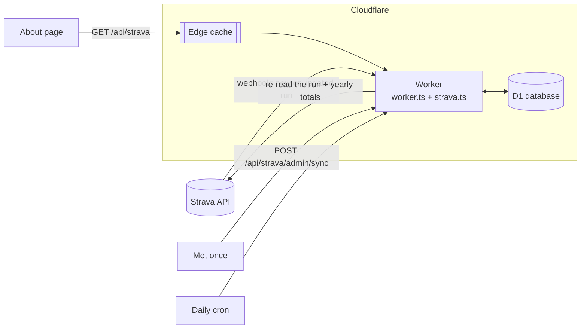
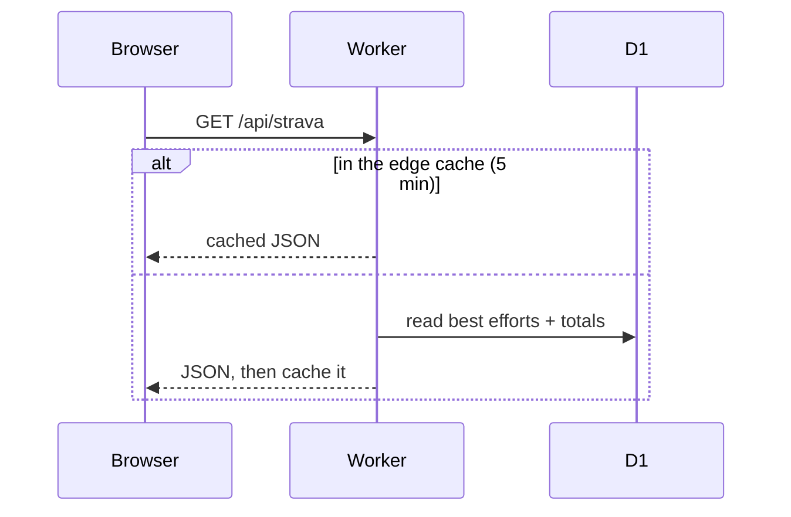
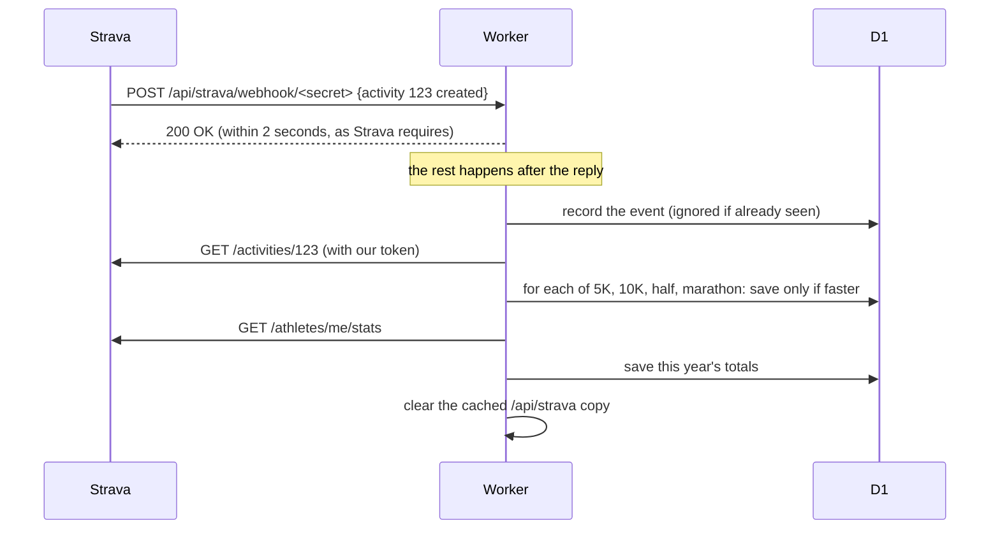

# Strava Best Efforts on jodev.co.za

The About page shows my **Strava Best Efforts** (fastest 5K, 10K, half marathon and marathon) and my
running totals for the year, live from Strava. This document explains how the data gets there, why it's
built this way, and how it's kept secure.

The short version:
- **Seeding:** the best efforts are seeded once from the two runs that hold them.
- **New runs:** Strava then pings the site through a webhook. The site re-reads the run from Strava and keeps any time that beats a stored one.
- **Page views:** visitors never cause a call to Strava. They read a small, cached copy of the numbers.

## How it fits together



| Piece | What it does |
|---|---|
| `strava.ts` | Everything Strava: routes, webhook handling, token storage, syncing, the daily job |
| `worker.ts` | Sends `/api/strava*` to `strava.ts` and runs the daily cron |
| D1 (`DB`) | Stores the encrypted tokens, the best efforts, the yearly totals and recent webhook events |
| `src/components/StravaStats.tsx` | The cards on the About page |
| `scripts/strava.mjs` | One-time setup on my own machine: connect the account, create the webhook subscription |

## The flows

### A visitor opens the About page



The response only ever contains: distance name, time in seconds, the date (no time of day), the Strava
activity id (for the "View on Strava" link) and the yearly run count, distance and moving time.

### I finish a run



Strava's best efforts are matched by distance (5000 m, 10000 m, 21097.5 m, 42195 m), not by label, and
use elapsed time, the same as Strava's own PRs. Only runs count: Run, TrailRun and VirtualRun.

"Only if faster" is a single SQL statement per distance:

```sql
INSERT INTO strava_best_efforts (name, seconds, date, activity_id) VALUES (?, ?, ?, ?)
ON CONFLICT (name) DO UPDATE SET seconds = excluded.seconds, date = excluded.date, activity_id = excluded.activity_id
WHERE excluded.seconds < strava_best_efforts.seconds
```

Two events arriving at once can't put a slower time back, because the comparison and the write happen together.

### Seeding

Rather than syncing years of history, which is one API call per run, the starting values come from the two
activities that already hold every best effort:

```sh
curl -X POST https://jodev.co.za/api/strava/admin/sync \
  -H "Authorization: Bearer $ADMIN_TOKEN" -H "Content-Type: application/json" \
  -d '{"activityIds":[16662915293,17467753044],"stats":true}'
```

The endpoint takes activity IDs only. It fetches them from Strava and runs them through the same "only if
faster" rule as webhooks. It never accepts times or other data. It then clears the cached copy of
`/api/strava`, so the new numbers show straight away.

### Every day at 03:00 UTC

- Refreshes the yearly totals, so they reset on 1 January even if I haven't run.
- Retries webhook events that failed (for example because Strava was down).
- Forgets events older than 30 days.

## Data model

All tables are created on first use (`CREATE TABLE IF NOT EXISTS`), so there are no migrations to run.

| Table | Columns | Notes |
|---|---|---|
| `strava_tokens` | `id` (always 1), `box` | Access + refresh token, AES-256-GCM encrypted |
| `strava_best_efforts` | `name`, `seconds`, `date`, `activity_id` | One row per distance |
| `strava_stats` | `id` (always 1), `ytd`, `updated_at` | `ytd` is `{ runs, metres, seconds }` |
| `strava_events` | `activity_id`, `aspect`, `event_time`, `status` | Dedupes webhook retries; `pending`, `done` or `failed` |

## Security

Strava access is a personal account, so the design assumes every public URL will be poked at.

| Risk | What stops it |
|---|---|
| Leaked secrets in the repo | None are in it. Everything sensitive is a Wrangler secret (`.dev.vars` locally, which is gitignored). |
| A database export or backup leaking the Strava tokens | Tokens are encrypted with AES-256-GCM before they're stored. The key (`STRAVA_TOKEN_KEY`) is a secret, never in D1. |
| Fake webhook events (Strava doesn't sign them) | The webhook URL contains a random 256-bit secret; anything else is a 404. Events must name our athlete and our subscription. The event is only a hint: the run is always re-read from Strava with our own token, and checked to be mine. A forged event can at most make the site re-read one of my own runs. |
| Webhook floods or replays | Rate limited (`STRAVA_LIMIT`), body size capped, each event processed once. |
| Someone using the admin sync | `Authorization: Bearer` with a random 256-bit token, compared in constant time, rate limited per IP. It only accepts up to 10 numeric activity IDs. |
| Guessing secrets by timing | Every secret comparison hashes both sides and compares the digests in constant time. |
| A missing secret leaving something half-open | Each route checks its settings first and answers 404 if anything is missing (CI and tests run that way). |
| Revoking access in Strava | Strava sends a deauthorization event and the stored tokens are deleted straight away. |
| Leaking where I live or run | No GPS, maps, routes, start points or times of day are stored or returned. Dates only. |
| Too much access | OAuth scope is `read,activity:read`: public and followers-only activities, read only. |
| Tokens in logs or shell history | Logs only ever include status codes. The setup script pipes the refresh token straight into `wrangler secret put`, so it's never printed or typed. |
| SQL injection | Every query uses bound parameters; activity IDs must be positive integers. |
| Hammering `/api/strava` | Responses are cached at Cloudflare's edge for 5 minutes, so page views barely touch the database. |

There is no public OAuth route on the site at all: the one-time connection happens on my own machine.

## Endpoints

| Method + path | Who | Answer |
|---|---|---|
| `GET /api/strava` | Anyone | `{ bestEfforts: [{ name, seconds, date, activityId }], ytd: { runs, metres, seconds } \| null, updatedAt }` |
| `GET /api/strava/webhook/<secret>` | Strava, once | Echoes `hub.challenge` when `hub.verify_token` matches (subscription check) |
| `POST /api/strava/webhook/<secret>` | Strava | `200 {"ok":true}`, always the same, so it gives nothing away |
| `POST /api/strava/admin/sync` | Me | Body `{ "activityIds": [..], "stats": true }`, answers with the new public data |

## Setup

Everything sensitive is set with `npx wrangler secret put NAME`, which prompts for the value so it never
lands in shell history. For local runs, the same names go in `.dev.vars`.

| Name | Secret? | Where it comes from |
|---|---|---|
| `STRAVA_CLIENT_ID` | No | Strava API app settings |
| `STRAVA_CLIENT_SECRET` | Yes | Strava API app settings |
| `STRAVA_TOKEN_KEY` | Yes | `openssl rand -base64 32` |
| `STRAVA_WEBHOOK_SECRET` | Yes | `openssl rand -hex 32` (hex, because it goes in a URL) |
| `ADMIN_TOKEN` | Yes | `openssl rand -hex 32` |
| `STRAVA_REFRESH_TOKEN` | Yes | Set by `scripts/strava.mjs auth`; only used until the first refresh |
| `STRAVA_ATHLETE_ID` | No | Set by `scripts/strava.mjs auth` |
| `STRAVA_SUBSCRIPTION_ID` | No | Set by `scripts/strava.mjs subscribe` |

1. **Create the Strava app** at [strava.com/settings/api](https://www.strava.com/settings/api).
   - Website: `https://jodev.co.za`
   - Authorization Callback Domain: `jodev.co.za` (localhost and 127.0.0.1 are always allowed, which the setup script uses)
2. **Let the deploy create the database.** The GitHub `CLOUDFLARE_API_TOKEN` needs the **D1: Edit** permission. `wrangler.jsonc` has no `database_id`, so the first deploy creates the `jodev` database and later deploys reuse it.
3. **Set the secrets.** Put `STRAVA_CLIENT_ID`, `STRAVA_CLIENT_SECRET`, `STRAVA_TOKEN_KEY`, `STRAVA_WEBHOOK_SECRET` and `ADMIN_TOKEN` with `wrangler secret put`. Also add the client ID, client secret and webhook secret to `.dev.vars`, so the setup script can read them.
4. **Connect the account:** `node scripts/strava.mjs auth`. Open the printed link, approve, and the script stores `STRAVA_REFRESH_TOKEN` and `STRAVA_ATHLETE_ID`.
5. **Deploy:** GitHub Actions > Deploy > Run workflow.
6. **Create the webhook subscription:** `node scripts/strava.mjs subscribe`. Strava immediately checks the live callback, and the script stores `STRAVA_SUBSCRIPTION_ID`.
7. **Seed:** the `curl` under [Seeding](#seeding).

### Running it locally

`node scripts/strava.mjs auth --local` writes the refresh token and athlete ID to `.dev.vars` instead.
With the other names in `.dev.vars` too, `npm run preview` runs the whole thing against a local D1.
Plain `npm run dev` has no Worker, so the cards show "Couldn't load the Strava stats right now."

### Fixing a wrong best effort

The site only ever keeps faster times. To replace one (say a GPS glitch), delete it and re-sync the run that should hold it:

```sh
npx wrangler d1 execute jodev --remote --command "DELETE FROM strava_best_efforts WHERE name = '5K'"
# then the seeding curl with that activity's ID
```

## Limits and known gaps

- **API usage:** each new run costs 2 to 3 Strava requests (a token refresh at most every 6 hours, the run, the totals). Strava's default limit is 100 reads per 15 minutes and 1,000 per day.
- **Deleted or cropped PB runs aren't recalculated.** No history is kept, so the next-best time isn't known. Fix it by hand as above.
- **The yearly totals only count runs visible to Everyone.** That's Strava's rule for the stats endpoint, so followers-only runs aren't counted.
- **Updates can take up to 5 minutes to appear in some places.** Syncs clear the cached copy, but Cloudflare's cache is per data centre. A seed clears it in the data centre near me (and so near most visitors). A webhook clears it wherever Strava's request lands. Everywhere else the old copy expires within 5 minutes.
- **Missed webhooks:** if Strava gives up delivering an event (it tries 3 times), that run isn't checked unless it's edited later. A future improvement: have the daily job check the last couple of days of activities.

## Tests

- `test/strava.test.ts`:
  - which webhook events are acted on
  - which efforts are taken from a run (athlete, sport and distance checks, date only)
  - token encryption round trips
  - exact secret comparison
- `test/site.test.js`:
  - `/api/strava` answers with the public shape
  - the webhook and admin routes refuse strangers, both on a local copy and against the live site after each deploy
